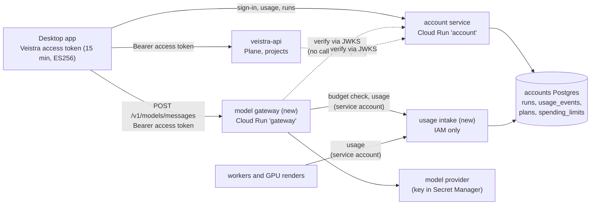

# Handoff: connect the Veistra app to the rest of its cloud services

From the accounts session, 2026-11-06. For the agent who connects the desktop app to Veistra's
cloud services through the Veistra account: the model gateway first, then metered cloud work,
then the cloud pages the app already has.

Two repositories, both needed:

- **App:** `Firelight-Innovations/Veistra`, this one (the Tauri app, `infra/`, `services/`).
- **Website:** `Firelight-Innovations/Veistra-Website`. It holds the account service
  (`services/account/`) and is where a new server beside it belongs.

Paths below are relative to the repository named, `A/` for the app and `W/` for the website.

## The goal, and how you know you are done

Today the app talks to two separate worlds.

1. **The Veistra account.** Sign-in, usage, runs, plan credits, the spend limit and the profile
   picture are built and live. It runs on Cloud Run with Postgres on Cloud SQL, and the app
   reaches it with a 15-minute ES256 access token.
2. **The Google Cloud stack in `veistra-prod`.** This is the Plane gateway, agent VMs, the GPU
   node, Hindsight and the cost tracker. The app reaches all of it with Braden's own `gcloud`
   credentials or his Google OAuth sign-in. Cloud Run IAM lets in only
   `user:braden.seaborn@firelightinnovations.com`. Every page that uses it is switched off in the
   app.

Integration means three things:
- the app reaches Veistra's cloud services **as the signed-in Veistra account**;
- billed work lands in the account's **`usage_events` and `runs`**, against the right
  workspace;
- **plan credits and the spend limit hold** for that work.

You are done when all of this holds, phase by phase:

1. **Billing through the gateway.** A Veistra-harness model call goes through the new model
   gateway with the account's access token. It shows as a billed run, with tokens and cost, on
   `veistra.com/dashboard` and in Settings → Usage, with the same numbers in both.
2. **Credits and the limit.** Plan credits pay for that call first. Past them, a workspace with
   `pause_at_limit` gets `402 limit-reached` from the gateway, and the app says so and links to
   the usage page.
3. **Cloud work is metered.** A cloud-worker job and a GPU render each write `cloud_worker` or
   `gpu_render` usage to the workspace that asked for them.
4. **No `gcloud` for moved services.** Every service moved to Veistra tokens (veistra-api first)
   works for a signed-in person with no `gcloud` on their PATH.
5. **Checks and contracts.** `pnpm verify` passes in both repositories. Every new account-service
   route is in `W/services/account/openapi.yaml` and in both `docs/account-api.md` files.

Phases 1 and 2 are the core. Phase 3 depends on decisions only Braden can make (§2), so stop and
ask before building past them.

## Read first

- Both `CLAUDE.md` files. They set the rules this handoff assumes: `pnpm verify`, the ports, the
  size budget, and no secrets in commits.
- `W/services/account/openapi.yaml`: the account service's whole contract, machine-readable. Its
  drift test (`openapi.test.ts`) fails when a route is added without it.
- `W/docs/account-api.md` and `A/docs/account-api.md`: the prose contract, and why each rule
  exists.
- `W/services/account/migrations/002_usage.sql` (`runs`, `usage_events`, `spending_limits`),
  `006_plans.sql` (plans and their included credits) and `007_avatars.sql`.
- `W/services/account/tokens.ts`: the access token, and why it is a JWT (§3).
- `A/docs/handoffs/accounts-live-2026-11.md` §3.2: the gateway as first designed. Its banner
  flags the parts that were superseded.
- `A/docs/design/VEISTRA-HARNESS.md` §2. The harness uses the person's own key today. "The Veistra
  account as a model provider" is listed under "Not in this cut".
- `A/docs/cloud-services.md`, `A/veistra-cloud.md` (the cloud PRD) and
  `A/docs/design/CLOUD-SYSTEM-DIAGRAM.md`. Their status lines are stale; see §7.
- `A/infra/README.md`, `A/services/veistra-api/README.md` and `A/infra/deploy.sh`.
- `A/src-tauri/src/account/` (the account client) and `A/src-tauri/src/cloud/` (every Google Cloud
  call the app makes today).

## State on 2026-11-06

| Area | State | Where |
|---|---|---|
| Account sign-in (RFC 8628), `/v1/me`, devices, API keys | **Built, live** | `W/services/account/`, `A/src-tauri/src/account/` |
| Usage, runs, plan credits, spend limit | **Built, live.** Billed totals are always 0: nothing writes `usage_events` | `GET /v1/usage`, `/v1/runs`, `PUT /v1/limits` |
| Claude Code and Codex sessions as unbilled runs | **Built**, in Firelight-Innovations/Veistra#355 (open) | `A/src-tauri/src/account/runs.rs` |
| Plans with included credits; profile picture | **Built**, in Firelight-Innovations/Veistra-Website#24 (open), migrations 006 and 007 | `W/services/account/` |
| Model gateway, `POST /v1/models/messages` | **Not built.** Designed in accounts-live §3.2. The app already parses its `402` (`A/src-tauri/src/account/tests.rs`, `limit-reached`) | — |
| Anything that writes `usage_events` | **Not built.** `store.addUsage` exists and only tests call it | `W/services/account/store/` |
| `pause_at_limit`, the 80% email | **Stored, not enforced** | `spending_limits` |
| `usage_daily` rollup | **Not built**, on purpose (`002_usage.sql`). `A/docs/account-api.md` wrongly says past days come from it | — |
| API keys (`vst_live_…`) | **Issued, accepted nowhere.** Nothing updates `last_used_at` | `POST /v1/keys` |
| veistra-api (Plane gateway, Cloud Run, Python) | **Code built, never run against the live project** (its README says so). IAM invokers: Braden. App setting `cloud.gatewayUrl` defaults to empty | `A/services/veistra-api/`, `A/infra/terraform/veistra-api/`, `A/src-tauri/src/cloud/gateway.rs` |
| Plane CE on `plane-vm` over an IAP tunnel | **Infra built**; the Plane page is **off** | `A/infra/terraform/plane/`, `A/src-tauri/src/cloud/tunnel.rs` |
| Agent VM `veistra-worker`, GPU `veistra-gpu`, session and render buckets | **Infra built**; the Cloud agents page is **off**. The app calls Google APIs with a `gcloud` access token | `A/infra/terraform/{worker,gpu}/`, `A/src-tauri/src/cloud/{compute,storage,auth}.rs` |
| Hindsight (agent memory) | **Cloud Run, live**; the app has a health check only; the page is **off** | `A/src-tauri/src/cloud/hindsight.rs` |
| Cost tracker | **Built**; the page is **off**; reads GCP billing with `gcloud` | `A/src-tauri/src/apps/costs.rs` |
| Artifact registry, design-canvas sync | **Planned only** | `A/docs/cloud-services.md` |

**The pages are off by the owner's call.** Plane, Cloud agents, Hindsight and Cost are switched
off in `A/src-tauri/src/pages.rs` ("the rail shows Agents only"). Turning one back on is one flag,
and it is Braden's call, not yours.

**Merge the two open PRs first.** #24 adds migrations 006 and 007, which phase 1 reads; #355 adds
`Account::write` and the run recorder.

## 1. The shape of the integration



There are two rules, and the rest of this handoff follows from them.

1. **The person's Veistra access token is the one credential the app sends to Veistra's cloud.**
   - Each service checks it itself against the account service's public keys at
     `GET /.well-known/jwks.json`, without calling the account service per request. That is why
     the token is a JWT (`W/services/account/tokens.ts`).
   - The token is ES256.
     - `iss` is the service's `ACCOUNT_ISSUER` (`https://veistra.com` in production).
     - `aud` is `veistra`.
     - The other claims are `sub` (user), `ws` (workspace), `dev` (device) and `scope: "app"`.
     - It lives 15 minutes.
   - A signed-out device's token stays valid until it expires. Accept that lag, and say so in
     each service's README.
2. **Usage is written by servers, as a Google service account, never by the app.**
   - `POST /v1/runs` already refuses a billed harness, so no client ever states a cost. Keep it
     that way.
   - Cloud-to-cloud calls use Cloud Run IAM with a dedicated service account per writer. They
     never forward a person's token.

## 2. Decisions to get from Braden before you build past them

Put each to him with the recommendation, then record the answer in this file. In each item
below, the recommendation comes first.

- **D1. How usage reaches the accounts database.**
  - **Recommended:** a second Cloud Run service built from the account service's image.
    - It runs in an intake mode that serves only internal routes:
      - `POST /internal/v1/usage` writes a billed run and its usage events in one transaction;
      - `GET /internal/v1/budget/{workspace}` returns credits left, the limit, spend past
        credits, and whether billed work is paused.
    - It has no `allUsers` invoker and is not behind Firebase Hosting. Only the gateway's and the
      workers' service accounts may invoke it.
    - The accounts database keeps one owner, and its schema stays private.
  - **The alternative:** give the gateway its own Postgres role, limited to inserts on `runs` and
    `usage_events`. That is faster, but it puts a second writer on the schema, and a second copy
    of the credits-and-limit arithmetic in `W/services/account/app.ts` (`month`, `limitJson`).
- **D2. Where the gateway's code lives.**
  - **Recommended:** `W/services/gateway/`, beside the account service. It then shares the store
    types and the deploy workflow (`W/.github/workflows/deploy.yml` builds and deploys after
    `verify`).
  - **The alternative:** `A/services/`, which `A/infra/deploy.sh` deploys by hand.
- **D3. Whether veistra-api accepts Veistra tokens.**
  - Cloud Run IAM accepts only Google-signed tokens. Accepting Veistra tokens means opening the
    service's IAM to `allUsers` and checking the JWT inside the service.
  - **Recommended:** yes, with a workspace allow-list (D4), so the app no longer needs `gcloud`
    for it.
  - This opens a public endpoint, so it is explicitly his call.
- **D4. Who may use single-tenant infrastructure.**
  - There is one Plane, one worker VM and one GPU node, built for Braden alone
    (`veistra-cloud.md`: "Braden Seaborn is the one user").
  - **Recommended:** a `CLOUD_WORKSPACES` allow-list in each service until there is
    per-workspace infrastructure. A token from any other workspace gets `403`, as a problem
    document.
- **D5. Prices.**
  - What does each unit cost in micro-dollars: an input token, an output token, a worker-second,
    a GPU-second? Is idle VM time billed?
  - **Recommended:** a `prices` table (a new additive migration in `W/services/account/`), read
    by the intake service, so a price change is an `update` and not a release, as `plans` already
    works.
  - Braden sets the numbers.
- **D6. Turning the cloud pages back on.** Not yours to flip. Ask once phase 3 makes a page work
  for a signed-in account without `gcloud`.

## 3. Phase 1: the model gateway

### 3.1 The service

**Deployment**
- Cloud Run `gateway` in `veistra-prod`, `us-central1`, called on its own `run.app` address.
- Never put it behind Firebase Hosting, which cuts a request at 60 s. The account service is
  deployed with `--timeout 30`, so the gateway must be its own service.
- Allow a timeout long enough for a long stream, and keep `--min-instances 0`.

**`POST /v1/models/messages`**
- The body is shaped like Anthropic's Messages API, `stream: true` is passed through as
  server-sent events, and the reply streams back as it arrives.
- Allow only an explicit list of models.
- The request carries `Authorization: Bearer <access token>`. Check it against the JWKS: cache
  the keys, and fetch them again when a `kid` is unknown. Check `iss`, `aud`, `exp` and `scope`.
- It also carries `Veistra-Request-Id: <uuid>`, which becomes the run's id so a retry is one run,
  and `Veistra-Project: <folder name>`, which is the same project name `runs.rs` sends.

**Before the call:** ask intake for the workspace's budget (D1).
- If billed work is paused (spend past credits ≥ limit, with `pause_at_limit`), answer `402` as a
  problem document with `type` `https://veistra.com/problems/limit-reached`.
- The app already maps that `type` to a sentence (§3.2).

**Billing**
- Bill after the stream ends, or at the point it broke, from the provider's own token counts.
- Write one billed run (`harness: veistra_harness`, `billed: true`, `tokens`, `cost_micros`)
  and its `usage_events` row (`source: veistra_harness`, `unit: token`).
- The intake service prices the usage (D5) and applies credits first, using the same arithmetic
  as `GET /v1/usage`'s `plan` and `limit`, so the dashboard's numbers come out unchanged.

**Credentials and limits**
- The provider key lives in Secret Manager (for example `gateway-model-key`), is mounted only into
  `gateway`, and is never sent to or stored by the app.
- Rate-limit per workspace and per device, as the account service does
  (`W/server/rateLimit.ts`).

**Problem documents (RFC 9457) everywhere**
- `401 invalid-token`: the app refreshes once and retries, as it does for the account service.
- `403 not-allowed`: the workspace is not on the allow-list (D4).
- `402 limit-reached`.
- `429`, with `Retry-After`.
- `502` when the provider fails.

**Contracts:** give the gateway its own `openapi.yaml`, and add it to both `docs/account-api.md`
files.

### 3.2 The app

- **A setting for the gateway's address.** Call it `account.gatewayUrl`, in the Account service
  group on the Developer page (`A/src-tauri/src/settings/schema.rs`), defaulting to the deployed
  `run.app` address. Do not reuse `cloud.gatewayUrl`, which is veistra-api's.
- **The Veistra harness learns the Veistra account as a provider.**
  - The harness lives in `A/packages/veistra-agent` and runs on Pi; see `VEISTRA-HARNESS.md` §2:
    "one more Pi provider, registered by a module in this package".
  - The open design point is how a long-running harness process gets a fresh 15-minute token.
    - Never write the token to disk, and never put it in the child's environment at launch,
      because it would expire there.
    - Read `A/crates/veistra-agent-host` for the channel the host already has to the harness.
      Add a request on it that answers `Account::access_token` (`A/src-tauri/src/account/mod.rs`),
      and nothing else.
- **`402 limit-reached` stops the run.** Show "Billed runs are paused: this workspace reached its
  monthly limit", with "Open on veistra.com" opening `usage` (already in `WEB_PAGES`,
  `A/src-tauri/src/account/methods.rs`). Claude Code and Codex sessions are untouched.
- **No double counting.** `runs.rs` keeps `Harness::Veistra => None`; the gateway records those
  runs.

### 3.3 Done check, phase 1

1. Run the gateway locally against the account service's memory store, with a fake provider:
   - a streamed call bills exactly the provider's token counts;
   - a broken stream bills what was reported up to the break;
   - a retried `Veistra-Request-Id` is one run;
   - a paused workspace gets `402`;
   - another workspace's token gets `403`.
2. On the live project, after Braden deploys:
   - make one call from the app;
   - check that the dashboard and Settings → Usage show the same run, tokens and cost;
   - check that the credits went down first.

## 4. Phase 2: metering cloud workers and GPU renders

- **Attribution.**
  - Each job must carry the workspace that asked for it. Jobs come from `plane-watch`
    (`A/services/plane-watch/`, `gs://veistra-projects/prod/jobs/{pending,claimed,done}`) and
    from the app.
  - Add `workspace_id`, and the person's user id, to the job record and to render-queue items
    (`gs://veistra-prod-render-queue`, `A/infra/gpu/render.sh`).
  - A job with no workspace is not billed. Log it, so it is visible.
- **Units.** Send seconds for both:
  - `cloud_worker` and `gpu_render`, unit `second`, quantity in seconds;
  - the app turns seconds into hours and minutes (`A/src/shell/settings/usage/usage.ts`,
    `quantityLabel`), and so does the website.
- **The writer.** Each machine writes as its own service account, through intake (D1):
  - one billed run per job (`harness: cloud_worker` or `gpu_render`);
  - usage events as the job runs or when it ends;
  - none for idle time unless D5 says otherwise.
- **The budget.** Check intake's budget before starting a job (§3.1). A paused workspace's job is
  refused before a VM wakes. The monthly budget is 150 USD, and nothing may keep a machine
  awake (`A/docs/cloud-services.md` §8).

## 5. Phase 3: the app's cloud services on Veistra tokens

Only after D3 and D4.

- **veistra-api** (`A/services/veistra-api/`):
  - check the Veistra JWT and the workspace allow-list;
  - in the app, send `Account::access_token` instead of the Google ID token
    (`A/src-tauri/src/cloud/gateway.rs`, which calls `google.rs` or `gcloud` today);
  - give `cloud.gatewayUrl` the deployed address as its default.
  - Its `/v1/plane/api/v1/*` proxy then lets the Projects app reach Plane without the IAP tunnel
    and the hosts-file entry.
- **Hindsight:** the same move, if it is to be reached by anyone but Braden.
- **The Cloud agents app** calls Google APIs directly, as the person
  (`A/src-tauri/src/cloud/{compute,storage}.rs`). A Veistra token cannot do that. It needs
  server-side endpoints, on veistra-api, for:
  - the instance list;
  - start and stop;
  - session records.

  Propose those before building them.
- **The cost tracker** reads Google Cloud billing for the owner. Leave it on `gcloud`: it is an
  owner tool, not a feature for an account.
- Then **D6**: ask Braden which pages to turn back on.

## 6. Reference

```sql
-- W/services/account/migrations/002_usage.sql
create table runs (
  id uuid primary key,                 -- the caller's, so a retry is one run
  workspace_id uuid not null references workspaces (id),
  user_id text not null references users (id),
  device_id uuid references devices (id),
  name text not null, project text not null default '',
  harness text not null check (harness in
    ('veistra_harness','claude_code','codex','cloud_worker','gpu_render')),
  status text not null default 'running' check (status in ('running','finished','failed')),
  started_at timestamptz not null, finished_at timestamptz,
  tokens bigint, cost_micros bigint, billed boolean not null);

create table usage_events (
  id bigint generated always as identity primary key,
  workspace_id uuid not null references workspaces (id),
  run_id uuid references runs (id),
  project text not null default '',
  source text not null check (source in ('veistra_harness','cloud_worker','gpu_render')),
  quantity bigint not null, unit text not null, cost_micros bigint not null,
  at timestamptz not null default now());
```

- **Plans** (`006_plans.sql`): `beta` includes $0, `pro` includes $10 a month. Credits are spent
  first, reset with the month and never roll over. The limit caps only spend past them.
- **Money** is integer micro-dollars, and days are UTC.
- **Names, never values:**
  - Website GitHub variables: `GCP_PROJECT`, `GCP_WIF_PROVIDER`, `GCP_DEPLOY_SA`.
  - Account service: Secret Manager `account-database-url` and `account-access-token-key`; Cloud
    SQL instance `veistra-accounts`, database `accounts`, on the `default` VPC. The app's infra
    uses the `veistra` VPC, so a service that reaches both needs thought.
  - App infra secrets: `claude-oauth-token`, `hindsight-database-url`, `plane-*`.

## 7. Small fixes found on the way

- **App docs.** Make these in the same PR as the code they touch, or in one small docs PR.
  - `A/docs/account-api.md` says past days come from `usage_daily`, which does not exist.
  - `A/TODO.md` items 1 and 2 are out of date: the harness exists, and runs are recorded.
  - `A/TODO.md` says `docs/handoffs/` was removed, but it was put back.
  - `A/docs/cloud-services.md`'s banner ("Everything below is deployed and live") contradicts
    veistra-api's README ("Nothing in this repository has run against the live project").
  - `A/docs/design/CLOUD-SYSTEM-DIAGRAM.md` cites `docs/design/VEISTRA-CLOUD-PRD.md`, which does
    not exist; the PRD is `A/veistra-cloud.md`. It also puts Hindsight on the worker VM, though
    it runs on Cloud Run.
- **Linux test failures.**
  - On Linux, six Rust tests fail the same way on `main`, because they assert Windows paths:
    `apps::files` ×2, `apps::trash`, `godot::runner`, `project::tests` and
    `veistra-tool-manifest`'s `rejects_absolute_dist_path`.
  - `godot::rpc::tests::status_on_main_is_writable_and_offers_the_editor` sometimes fails in a
    full parallel run. It writes a fake `godot` script and runs it, and Linux can refuse to run a
    file another thread still has open ("text file busy").
  - CI runs on Windows, so none of this blocks a PR. It does confuse a Linux session.

## Guardrails

- **Checks.** `pnpm verify` before every commit, in each repository. A failing test is never
  deleted or skipped. A bug fix comes with the test that would have caught it.
- **The app.** Never run `pnpm app`, `pnpm dev` or `tauri dev`; port 1420 is Braden's. To see the
  UI, use your own instance (`pnpm ui launch`, `pnpm probe --agent`), as `A/CLAUDE.md` describes.
- **Secrets.** No secret in a commit, in the app, in a log line or in an error. Provider keys and
  database URLs live in Secret Manager.
- **Clients never state a cost.** Billed usage comes only from server meters.
- **Migrations.** Account-service migrations are additive only. Every new route goes into
  `openapi.yaml` and both `account-api.md` files.
- **Budgets.** Do not raise a size budget (website) or a lint baseline (app) to make a check pass.
- **Public access.** Do not widen IAM, make a service public, or turn on a page without Braden's
  yes (D3, D6).
- **Deploys are Braden's.**
  - The website repo deploys from GitHub Actions on merge to `main`.
  - The app's infrastructure deploys by hand (`A/infra/deploy.sh`). Do not run `terraform apply`
    or `infra/deploy.sh` unless asked.
- **PRs.** Work on a branch, open a PR, and do not merge it yourself.

## Done check (do all of it, and report what you saw)

1. **D1–D6:** each has an answer from Braden, recorded in §2.
2. **Phase 1:** the gateway's tests cover §3.3 step 1. `pnpm verify` passes in both
   repositories, with the account store tests on Postgres
   (`ACCOUNT_TEST_DATABASE_URL`, as CI sets it).
3. **Phase 1, live:**
   - one billed call from a real Veistra, with the same numbers on the dashboard and in
     Settings → Usage;
   - the credits went down first;
   - a `402` once past the limit with pause on.
4. **Phase 2:**
   - a cloud-worker job and a GPU render each show as a billed run with seconds and cost, in the
     workspace that asked for them;
   - a job from a paused workspace never woke a machine.
5. **Phase 3:** each moved service works with no `gcloud` on PATH, and refuses a workspace that
   is not allowed.

## What to report back

- **Decisions:** D1–D6, as answered.
- **PRs:** the link to each.
- **What ran where:** what ran against the live project, and what only ran in tests. Never
  report a live check you did not see.
- **One real run:** its tokens, cost and credits as each surface showed them.
- **Leftovers:** anything this handoff got wrong, so the next one does not repeat it.
